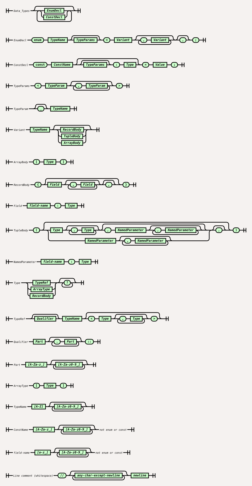
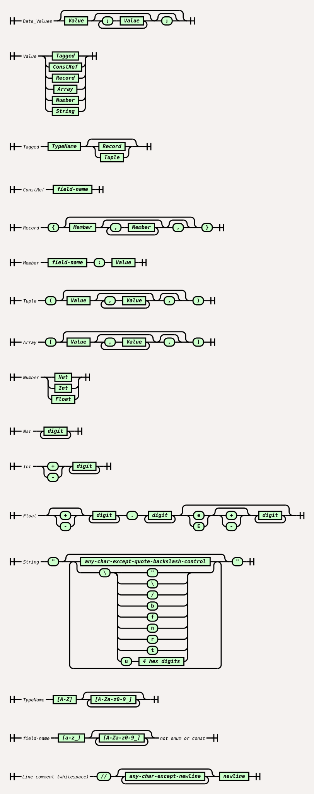

<!-- This file is generated by `just grammar-md` from grammar.template.md. Edit the template, not this file. -->

# Constructo grammar

Constructo has two notations that are used together. A **data-types** file declares a schema using Rust-style
`enum` declarations, and a **data-values** file holds data written in a JSON-like notation extended with named
constructors. The values are checked against the types.

For example, a types file might declare:

```
enum Shape =
  Circle { radius: Float },
  Box { width: Float, height: Float };
```

and a values file could then contain:

```
Circle { radius: 3.0 }
Box { width: 7.0, height: 1.0 }
```

The two grammars are given below as railroad diagrams. Both use `//` line comments, and the same `TypeName`
(uppercase initial) and `field-name` (lowercase or underscore initial) identifiers. The sources of the diagrams are
`dt_grammar_tabatkins.txt` and `dv_grammar_tabatkins.txt`, and the diagrams are built with `just build`. Example
files for each grammar are in [examples/](examples/).

## Data-types grammar

A types file is a sequence of `enum` declarations. Each declaration has optional type parameters and one or more
variants, which are bare constructors, records or tuples.

The rules are:

{{TYPES_RULES}}



The diagrams are also available as a [PDF](dt_grammar.pdf).

## Data-values grammar

A values file is a sequence of values: numbers, strings, arrays, records, tuples and constructors, written in the
untagged or tagged forms shown above.

The rules are:

{{VALUES_RULES}}



The diagrams are also available as a [PDF](dv_grammar.pdf).
