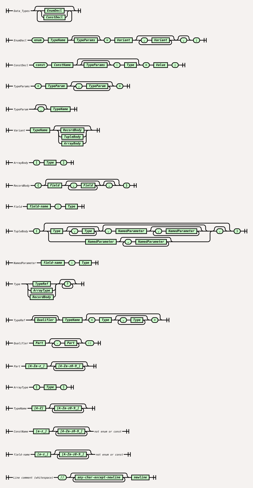
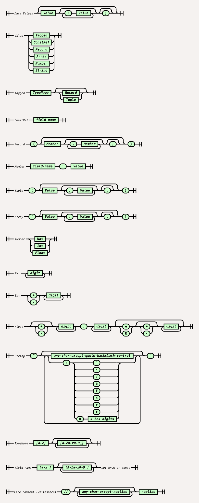
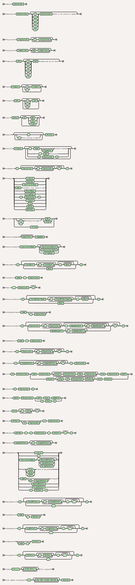

<!-- This file is generated by `just grammar-md` from grammar.template.md. Edit the template, not this file. -->

# Constructo grammar

Constructo has two notations that are used together. A **data-types** file declares a schema using Rust-style
`enum` declarations, and named values using `const` declarations. A **data-values** file holds data written in a
JSON-like notation extended with named constructors. The values are checked against the types. A third notation, the
**query** language of `constructo query`, extracts and transforms values with Rust-like expressions.

For example, a types file might declare:

```
enum Shape =
  Circle { radius: Float },
  Box { width: Float, height: Float };
```

and might name a value:

```
const unit_circle = Circle { radius: 1.0 };
```

and a values file could then contain:

```
Circle { radius: 3.0 };
Box { width: 7.0, height: 1.0 };
unit_circle
```

The three grammars are given below as railroad diagrams. All use `//` line comments, and the same `TypeName`
(uppercase initial) and `field-name` (lowercase or underscore initial) identifiers. The sources of the diagrams are
`dt_grammar_tabatkins.txt`, `dv_grammar_tabatkins.txt` and `dq_grammar_tabatkins.txt`, and the diagrams are built with
`just build`. Example files for each grammar are in [examples/](examples/).

## Data-types grammar

A types file is a sequence of `enum` and `const` declarations, in any order. A file whose first token is `enum` or
`const` is a types file.

An `enum` declaration has optional type parameters and one or more variants, which are bare constructors, records,
tuples or arrays. An array variant such as `Users[User]` holds an array whose elements have the one type in the
brackets, and it is a different form from the tuple `Users([User])`: a value of one is never accepted for the other.

A `const` declaration gives a name to a value. Its type is the `Type` after the colon, and it may be left out, in which
case the type of the value is used. The type parameters, as in `const none<T>: Option<T> = None;`, say that the const
has that type for every `T`. They belong to the type, so they can only be given together with it. The grammar shows
this, although the parser reads a parameter list without a type and the checker then rejects it. The type parameters
are in scope in the type only.

A `Type` can be followed by any number of `?`, each of which makes it optional: `Nat?` is `Option<Nat>`, `[Nat]?` is
`Option<[Nat]>` and `Nat??` is `Option<Option<Nat>>`. A `?` applies to the whole type before it, so the elements of an
array are made optional with `[Nat?]`. It is only shorthand, so it needs the prelude, or another `Option`, to be
declared.

A type, like a constructor or a const in a value, may be written with a `Qualifier` in front, which names a group or the
full name of a project, as in `bundle::Shape` or `com.example.shapes::Shape`. A declaration is never qualified. The
parts of a qualifier are identifiers of either case separated by dots, and what the qualifier refers to is decided when
the names are resolved, which is described with the projects.

The `Value` of a const is the one defined in the [data-values grammar](#data-values-grammar). A const name starts with a
lower-case letter or `_`, like a field name, so that it cannot be taken for a constructor, whose name starts with a capital
letter. The names `enum` and `const` are reserved, and cannot be used as the name of a const or a field, but they can be
parts of a qualifier, as in `const::Shape`.

The rules are:

{{TYPES_RULES}}



The diagrams are also available as a [PDF](dt_grammar.pdf).

## Data-values grammar

A values file is a sequence of values: numbers, strings, arrays, records, tuples and constructors, written in the
untagged or tagged forms shown above. A value may also be the name of a const.

A `Tagged` value or a `ConstRef` may have a `Qualifier` in front, as in `bundle::Circle { radius: 1.0 }` or
`com.example.shapes::origin`, which is described with the types grammar above.

A bare name is a `Tagged` value if it starts with an uppercase letter and a `ConstRef` if it starts with a lowercase
letter or underscore. A `Tagged` value with no body is a constructor, and a `ConstRef` is always a
const and takes no body, so the form of a name says which it is without looking at any declaration. The standard prelude declares the consts `null`, `true` and
`false`, so these are ordinary names and not special literals.

A `Value` can be followed by any number of `?`, each of which wraps it in `Some`: `0?` is `Some(0)`. This is
experimental, and is rejected unless it is switched on with `--experimental=some-query` (or `-x`, which switches on
every experimental feature). Like the `?` on a type it applies to the whole value before it, and needs `Some` to be
declared.

The rules are:

{{VALUES_RULES}}



The diagrams are also available as a [PDF](dv_grammar.pdf).

## Query grammar

A query is one expression, given on the command line of `constructo query`, as in `#values.map(|m| m.x)`. It is Rust's
expressions with the changes that [decision 44][decision-44] makes, and what the language means is in the [specification
of the query command](../docs/specs/query-command.md). This section says only how a query is written.

[decision-44]: ../docs/decisions/0044-queries-are-rust-like-expressions-over-a-stream-of-values.md

The diagrams give one rule for each level of precedence, from the loosest to the tightest:

| Level | Operators | Associativity |
|---|---|---|
| `Expression` | `=` `+=` `-=` `*=` `/=` `%=` | none: only one, and only in the closure of `update` |
| `Disjunction` | `\|\|` | left |
| `Conjunction` | `&&` | left |
| `Comparison` | `==` `!=` `<` `<=` `>` `>=` | none: `a < b < c` is an error |
| `Sum` | `+` `-` | left |
| `Product` | `*` `/` `%` | left |
| `Cast` | `as Nat`, `as Int`, `as Float` | left |
| `Unary` | `!` `-` | prefix |
| `Postfix` | `.field`, `.method(...)`, `.0`, `[i]` | left |

The `Nat`, `Float`, `String`, `TypeName` and `Qualifier` of the diagrams are those of the
[data-values grammar](#data-values-grammar), and a constructor is named as in a values file, as `Circle`,
`shapes::Circle` or `acme.shapes::Circle`. A `name` starts with a lower-case letter or `_`, like a field name, but the
reserved words are different. The keywords of a query are `if`, `then`, `elseif`, `else`, `endif`, `match`, `with`,
`endmatch`, `as` and `_`, so none of them can be a variable, while `enum` and `const` can. A name that a closure or a
pattern binds is a variable. Any other name is a const of the types, which only a typed query may refer to, and which
may have a `Qualifier` in front, as in `shapes::origin`; `true`, `false` and `null` of the prelude are always known. In
a pattern a lower-case `name` always binds, except those three, and never compares with a const: a guard does that.

The tokens differ from those of a values file in three ways:

- **A sign is never part of a number.** `n - 5` is a subtraction. A `+` or `-` that touches the number after it, with
  no space between, is joined to it as one `Literal`, so `-1` is still a literal. A signed whole number is an `Int`,
  as in a values file. A `-` with a space after it is the operator `Unary` shows, so `- 1` is the negation of `1`.
- **After a `.` a number is digits only,** so that `v.0.1` is two positions, as in Rust, and not `v` followed by the
  `Float` `0.1`.
- **There are operators and keywords,** and `#values`, the stream of input values, is a single token. Any other word
  after `#` is an error. The `@` of a pattern is the binding, as in Rust, with or without spaces around it.

The diagrams allow some things that are refused after parsing, and say less than the parser about others:

- **Braces are never blocks.** `{` starts a record, except for the braces of a `Branch` of `if` and those around the
  `Arms` of `match` in Rust's form. A closure is not called directly, only passed to a method. In the condition of those
  forms a constructor followed by `{` is taken without the record when the record would swallow the branch, as in Rust,
  so `if v == None { 1 } else { 2 }` works. The outfix forms, `if ... then ... endif` and `match ... with ... endmatch`,
  have no such case, and every brace in them is a record.
- **Field shorthand,** `Point { x, y }` for `Point { x: x, y: y }`, is allowed only after a constructor name, as in
  Rust, which is why `ConstructorRecord` and `RecordExpr` are separate rules. A field may be given only once.
- **In a constructor's tuple** the positional arguments come before the named ones, as in a values file.
- **The `..` of a pattern** may only come last. In an array, bare or as a constructor's body, `name @ ..` binds the
  rest to an array, as a slice pattern does in Rust. A record or a tuple has no such binding, as in Rust.
- **A closure's parameters** are single patterns: an alternative `p | q` needs parentheses, since `|` ends the list.
  A closure with no parameters is written `| |`, with a space, because `||` is the `Disjunction` operator.
- **`matches!`** is the name `matches` followed by `!`, as in Rust, and is not a macro: no other name may be followed
  by `!`.
- **An assignment** is read anywhere that an `Expression` is, but is refused after parsing unless it is the body of
  the closure of `update`, and its target is a place that the access syntax reaches from the closure's parameter.
- **A `match`** needs at least one arm, and an `if` needs its `else`, since every expression gives a value.
- **The nesting** of a query is limited, so that a deeply nested query is refused rather than read with unbounded
  recursion. The links of a chain of operators, of `as` or of postfix accesses each count as a level.

The rules are:

{{QUERIES_RULES}}



The diagrams are also available as a [PDF](dq_grammar.pdf).
